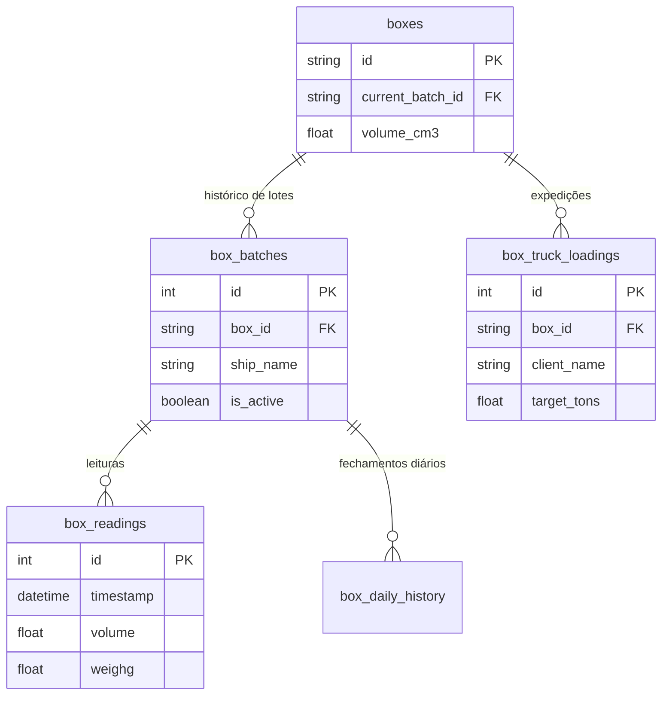

# Estrutura do Banco de Dados

Este documento descreve a estrutura atual do banco de dados (mapeada via SQLAlchemy no backend).

## Tabelas e Relacionamentos

### 1. `boxes`
Armazena a configuração estática e o estado atual de cada box.
- `id` (String, PK): Identificador único do box (ex: "box-01")
- `name` (String): Nome amigável (ex: "BOX 01")
- `status` (String): "vazio" ou "ocupado"
- `material_id` (String, nullable): ID do material atual
- `capacity_cm3` (Float): Capacidade total do box
- `volume_cm3` (Float): Volume atual medido
- `lidar_status` (String): "online", "offline", "erro"
- `geometry_length_cm` (Float): Comprimento do box (default: 47.62)
- `geometry_width_cm` (Float): Largura do box (default: 17.5)
- `geometry_height_cm` (Float): Altura do box (default: 16.0)
- `current_batch_id` (Integer, FK -> box_batches.id): Lote (navio) ativo no momento

### 2. `box_batches` (Lotes / Navios)
Representa as operações de recebimento de material para um box (historico de lotes de navio).
- `id` (Integer, PK): Identificador único do lote
- `box_id` (String, FK -> boxes.id): Box associado
- `ship_name` (String): Nome do navio de origem
- `material_id` (String): ID do material recebido
- `expected_weight_g` (Float, nullable): Peso esperado de recebimento
- `start_date` (DateTime): Data de início da alocação
- `end_date` (DateTime, nullable): Data de término
- `is_active` (Boolean): Se é o lote que está operando no momento

### 3. `box_readings` (Leituras do LiDAR)
Histórico pontual das varreduras do sensor para cada box/lote.
- `id` (Integer, PK)
- `box_id` (String, FK -> boxes.id)
- `batch_id` (Integer, FK -> box_batches.id)
- `timestamp` (DateTime): Data e hora da varredura
- `volume` (Float): Volume detectado ($m^3$)
- `weight` (Float): Peso calculado (t)
- `material_id` (String, nullable): Produto lido
- `lidar_status` (String): Status do sensor no momento

### 4. `box_daily_history` (Histórico Diário)
Fechamentos diários para rastreabilidade de volume e peso.
- `id` (Integer, PK)
- `box_id` (String, FK -> boxes.id)
- `batch_id` (Integer, FK -> box_batches.id)
- `date` (Date): Data do fechamento
- `initial_volume` (Float): Volume no início do dia
- `initial_weight` (Float): Peso no início do dia
- `final_volume` (Float): Volume no fim do dia
- `final_weight` (Float): Peso no fim do dia
- `material_id` (String, nullable)

### 5. `box_truck_loadings` (Carregamentos de Caminhão/Expedição)
Registro das operações de saída (expedição rodoviária) programadas e executadas.
- `id` (Integer, PK)
- `box_id` (String, FK -> boxes.id)
- `client_name` (String): Nome do cliente
- `target_tons` (Float): Meta de carregamento em toneladas
- `loaded_tons` (Float): Toneladas já carregadas
- `start_time` (DateTime): Início do carregamento
- `end_time` (DateTime): Fim do carregamento

## Diagrama de Entidade-Relacionamento Simplificado

